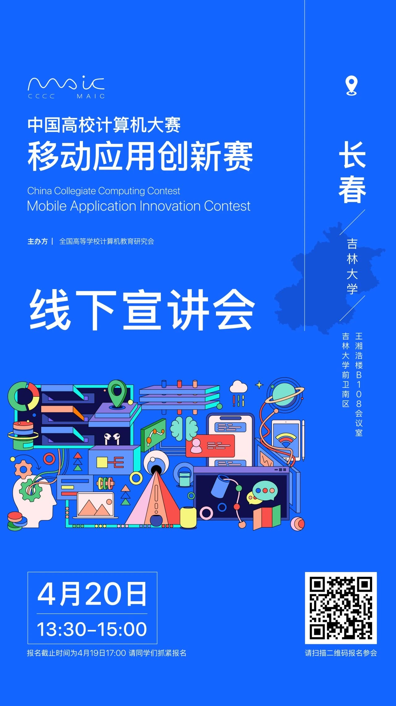
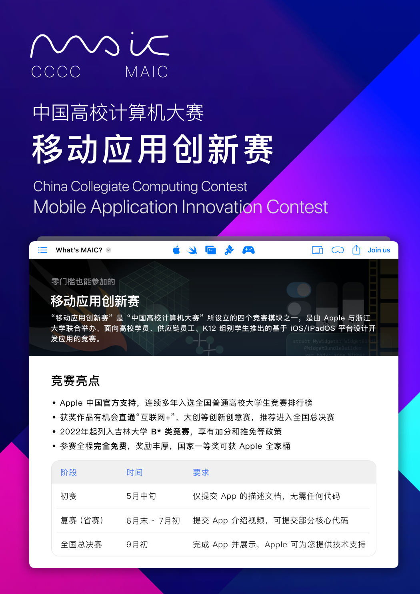
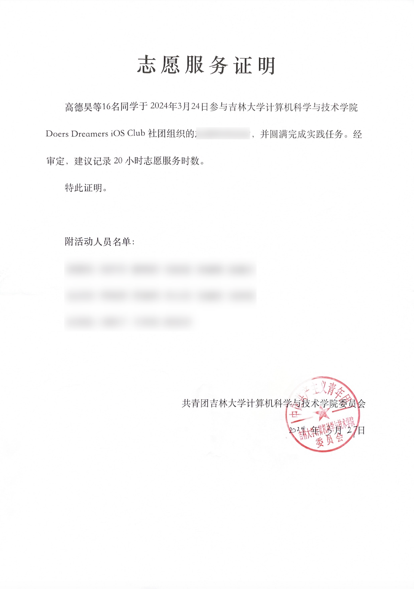

<MagHero title="移动应用创新赛——官方宣讲会来啦！" />

<MagGrid :cols="4">
  <MagCard title="日期">2024年<strong>04月20日</strong></MagCard>
  <MagCard title="时间">下午 13:30-15:00</MagCard>
  <MagCard title="地点">南区计算机楼 B108 会议室</MagCard>
  <MagCard title="主讲人">上海交通大学-董占勋 MAIC 组委会秘书-曹颖萍</MagCard>
  <MagCard title="参与报名"><a href="https://www.wjx.cn/vm/tUo0G8e.aspx">报名链接</a></MagCard>
  <MagCard title="报名截止时间">4月19日 17:00，请同学们抓紧报名</MagCard>
</MagGrid>

## 活动概述

“移动应用创新赛”是 “中国高校计算机大赛” 所设立的四个竞赛模块之一，是由 Apple 与浙江大学联合举办、面向高校学员、供应链员工、K12 组别学生推出的基于 iOS/iPadOS 平台设计开发应用的竞赛。

为了更好地组织推广移动应用创新赛，官方组委会在长春安排了一场宣讲会，选址在吉林大学前卫南区。此次宣讲会为官方性质，会带来**更多作品案例**分享，组委会老师也会在现场为大家答疑。

本次宣讲会由**上海交通大学董占勋老师**，和**移动应用创新赛组委会秘书曹颖萍老师**作为主讲嘉宾，JLU iOS Club 作为协办团队共同主持。

## 竞赛亮点

- **Apple 中国官方支持**，连续多年入选全国普通高校大学生竞赛排行榜
- 获奖作品有机会直通“互联网+”、大创等创新创意赛，推荐进入**全国总决赛**
- 2022年起列入吉林大学 **B* 类竞赛**，享有加分和推免等政策
- 参赛全程**完全免费**，奖励丰厚，国家一等奖可获 **Apple 全家桶**

<MagButton block href="/competitions/maic/">🔗 了解更多竞赛信息</MagButton>

## 活动奖励

1. 组委会会为参与宣讲会活动的同学发放小礼品
2. 现场参与互动答疑的同学可额外获得礼品！
3. 学院会为到场同学开取约 30 小时的志愿时长证明

## 活动流程

<MagTimeline>
  <MagTimelineItem tag="13:30" title="活动开场">
    主讲人：JLU iOS Club
  </MagTimelineItem>
  <MagTimelineItem tag="13:30～14:40" title="移动应用创新赛宣讲">
    主讲人：上海交通大学 董占勋
  </MagTimelineItem>
  <MagTimelineItem tag="14:40～15:00" title="互动答疑 + 合影">
    主讲人：组委会秘书 曹颖萍
  </MagTimelineItem>
</MagTimeline>

## 🔥 加入2024-MAIC竞赛群

## 关注 JLU iOS Club

<dualQRCode/>

