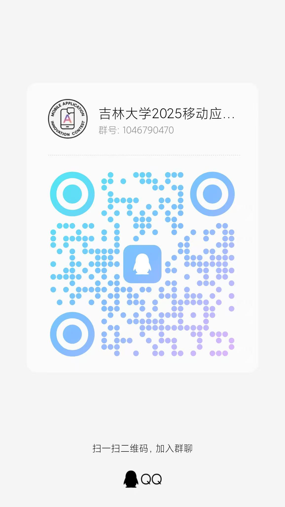

<MagArticle :title="$frontmatter.title" :description="$frontmatter.description" :date="$frontmatter.date" issue="01" category="竞赛交流 · 2025" kind="活动介绍" author="JLU iOS Club" date-label="记录日期" :next="{ title: 'AI 工作坊，从模型到应用', href: '/activities/250518-ai-workshop/' }">

2025 年 5 月 11 日，JLU iOS Club 在前卫南区计算机楼 B110 开展移动应用创新赛宣讲。谷方明老师的指导与往届获奖同学的经验分享，为新的参赛者提供参考。

**日期。** 2025年<strong>05月11日</strong>

**时间。** 晚 19:00

**地点。** 南区计算机楼 B110

**主讲人。** 吉林大学MAIC的指导教师谷方明

**竞赛官网。** <a href="https://www.appcontext.net">竞赛官网</a>

## 活动亮点

<MagFigure caption="活动海报">

</MagFigure>

“移动应用创新赛”是 “中国高校计算机大赛” 所设立的四个竞赛模块之一，是由 Apple 与浙江大学联合举办、面向高校学员、供应链员工、K12 组别学生推出的基于 iOS/iPadOS 平台设计开发应用的竞赛。

为了更好地组织推广移动应用创新赛，JLUiOSClub安排了一场宣讲会，选址在吉林大学前卫南区。

## 竞赛亮点

- **Apple 中国官方支持**，连续多年入选全国普通高校大学生竞赛排行榜
- 获奖作品有机会直通“互联网+”、大创等创新创意赛，推荐进入**全国总决赛**
- 2022年起列入吉林大学 **B* 类竞赛**，享有加分和推免等政策
- 参赛全程**完全免费**，奖励丰厚

## 活动流程

1️⃣吉林大学MAIC的指导教师谷方明老师进行有关移动应用创新赛的讲解和指导🎉🎉🎉

2️⃣上届获奖同学关于比赛经验的分享🎉🎉🎉

🌈竞赛介绍
移动应用创新赛，是2017年中国高校计算机大赛( China Collegiate Computing Contest)所设立的四个竞赛模块之一，本届大赛由浙江大学与苹果公司承办。

## 加入2024-MAIC竞赛群 {#🔥-加入2024-maic竞赛群}

<MagFigure caption="竞赛群二维码">

</MagFigure>

</MagArticle>
