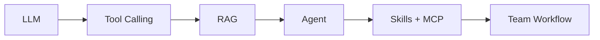
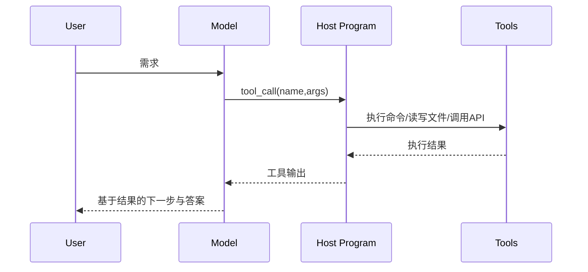
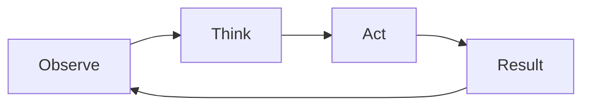

<MagNote type="tip" title="先动手，再回来看全景">

第一次接触 AI 编程，可以先读 [从想法到作品](/resources/ai-programming/)，沿贪吃蛇项目认识协作、Skill 与 MCP，再用本讲座补齐概念关系。

</MagNote>


<MagHero title="主线之外 · 现代 AI 编程全景" subtitle="这份讲义是主线之外的补充版本，目标不是“再背几个名词”，而是建立一张能直接指导你做项目的 AI 编程路线图。">
  <div class="mag-badge-row">
    <MagBadge>LLM</MagBadge>
    <MagBadge>Tool Calling</MagBadge>
    <MagBadge>RAG</MagBadge>
    <MagBadge>Agent</MagBadge>
    <MagBadge>Skills + MCP</MagBadge>
    <MagBadge>iOS 落地路径</MagBadge>
  </div>
</MagHero>

<MagGrid :cols="4">
  <MagCard>
    <h3>你会得到什么</h3>
    <p>一张分层概念地图，知道每个词解决什么问题，不再“术语堆砌”。</p>
  </MagCard>
  <MagCard>
    <h3>核心思维</h3>
    <p>从“写 prompt”升级到“定义规范、构建闭环、评估结果”。</p>
  </MagCard>
  <MagCard>
    <h3>工程目标</h3>
    <p>把 AI 从一次性回答器，变成能持续完成任务的系统。</p>
  </MagCard>
  <MagCard>
    <h3>适配对象</h3>
    <p>面向 iOS/Apple 开发者，覆盖课堂项目与团队协作场景。</p>
  </MagCard>
</MagGrid>

<MagNote type="tip">
  <strong>阅读建议：</strong> 先看第 2 节路线图和第 12 节总结，再按 3~11 节逐步补细节。每节都带了“能落地”的判断标准。
</MagNote>

## 目录

1. 这节课想解决什么问题
2. 整体路线图：五个台阶
3. 第一阶：LLM
4. 第二阶：Tool Calling
5. 第三阶：RAG
6. 第四阶：Agent
7. 第五阶（上）：Skills
8. 第五阶（下）：MCP
9. vibe coding：一种工作方式
10. vibe coding 实战：六条对抗熵增的机制
11. 现代编程范式的四个转变
12. 面向 iOS/Apple 的成长路径
13. 总结：完整概念地图

## 1) 这节课想解决什么问题

<MagStep n="1" title="把“会用 AI”升级为“会设计 AI 工作流”">
  <p>很多同学已经会用 ChatGPT / Claude / Cursor 写代码，但在工程层面还会卡在三个关键问题：能不能验证、能不能复用、能不能团队协作。</p>
  <ul>
    <li>为什么有时编译通过，有时出现不存在的 API？</li>
    <li>Agent 和普通对话到底差在哪？</li>
    <li>RAG / Tool Calling / MCP 是并列概念还是上下层关系？</li>
  </ul>
  <p>本讲义目标就是把这些问题压缩成一套可执行框架。</p>
</MagStep>

## 2) 整体路线图：五个台阶

<MagStep n="2" title="五层不是替代关系，而是叠加关系">
  <MagGrid :cols="5">
    <MagCard compact title="第 1 阶 LLM">会生成，但没手没眼没记忆</MagCard>
    <MagCard compact title="第 2 阶 Tool Calling">可执行、可验证</MagCard>
    <MagCard compact title="第 3 阶 RAG">检索真实知识</MagCard>
    <MagCard compact title="第 4 阶 Agent">多步计划与闭环</MagCard>
    <MagCard compact title="第 5 阶 Skills + MCP">团队复用与标准化接入</MagCard>
  </MagGrid>
</MagStep>



## 3) 第一阶：LLM

<MagStep n="3" title="LLM 是聪明的大脑，但天生“孤立”">
  <ul>
    <li><strong>断网：</strong>知识冻结在训练截止日。</li>
    <li><strong>没手：</strong>不能直接运行 `xcodebuild` 或改你项目文件。</li>
    <li><strong>没记忆：</strong>超出上下文窗口后不会自动保留长期经验。</li>
  </ul>
  <p>“幻觉”不是偶然 bug，而是概率生成机制导致的结构性风险：它会优先生成“像答案”的文本，而不是“被验证的事实”。</p>
</MagStep>

<MagNote>
  <strong>工程结论：</strong> 只用 LLM 写代码，最多是“高效草稿”；要变成“可靠交付”，必须引入执行与检索能力。
</MagNote>

## 4) 第二阶：Tool Calling

<MagStep n="4" title="给模型一双手：从“能写”到“能验证”">
  <p>Tool Calling 的核心是：模型声明要调用什么工具，外部程序实际执行，再把结果回传给模型继续推理。</p>
</MagStep>



<MagGrid :cols="2">
  <MagCard>
    <h4>常见工具类型</h4>
    <p>终端编译、测试执行、文件系统、数据库查询、HTTP 请求、搜索引擎。</p>
  </MagCard>
  <MagCard>
    <h4>带来的质变</h4>
    <p>把“文本建议”升级为“工程闭环”：写完即跑、失败即修、可追踪可复现。</p>
  </MagCard>
</MagGrid>

## 5) 第三阶：RAG

<MagStep n="5" title="给模型一双眼：先查证再回答">
  <p>RAG（检索增强生成）解决的是“知识来源不可信”的问题。模型先检索你的知识库，再基于检索片段生成回答。</p>
  <ul>
    <li>可放入 README、架构约定、API 文档、历史踩坑记录。</li>
    <li>可显著减少“风格漂移”和“项目内 API 幻觉”。</li>
  </ul>
</MagStep>


<MagGrid :cols="2">
  <MagCard>
    <h4>Tool Calling 关注什么</h4>
    <p>执行动作与实时结果，例如编译、测试、调用 API。</p>
  </MagCard>
  <MagCard>
    <h4>RAG 关注什么</h4>
    <p>回答依据与知识正确性，例如规范、设计决策、接口约束。</p>
  </MagCard>
</MagGrid>

## 6) 第四阶：Agent

<MagStep n="6" title="从“一问一答”到“持续做事”">
  <p>Agent 的关键不是“会说话”，而是能在多步任务里持续循环：观察、思考、行动、再观察。</p>
</MagStep>



<MagGrid :cols="2">
  <MagCard>
    <h3>四大组件</h3>
    <ul>
      <li>Planning &amp; Reasoning：任务拆解和动态调整</li>
      <li>Memory：情节/语义/程序记忆</li>
      <li>Tools：能操作真实环境</li>
      <li>Environment：文件、Git、CI、外部服务</li>
    </ul>
  </MagCard>
  <MagCard>
    <h3>真实局限</h3>
    <ul>
      <li>长链路任务易跑偏</li>
      <li>早期误判会在后续放大</li>
      <li>幻觉触发错误行动链</li>
      <li>需要人工设置关键检查点</li>
    </ul>
  </MagCard>
</MagGrid>

## 7) 第五阶（上）：Skills

<MagStep n="7" title="把“会做”变成“稳定可复现地做”">
  <p>Skills 的价值是把团队隐性经验固化为可执行规则，避免同类任务每次都凭个人习惯随机发挥。</p>

```text
my-skill/
  SKILL.md
  scripts/
  templates/
  assets/
```
</MagStep>

<MagGrid :cols="2">
  <MagCard>
    <h3>模块创建 Skill</h3>
    <p>自动生成 Model / ViewModel / View / Tests，强制 MVVM 约束。</p>
  </MagCard>
  <MagCard>
    <h3>质量检查 Skill</h3>
    <p>统一跑 SwiftLint、格式化、测试，并输出质量摘要。</p>
  </MagCard>
  <MagCard>
    <h3>PR 生成 Skill</h3>
    <p>自动产出改动说明、风险点、review 重点和变更记录。</p>
  </MagCard>
  <MagCard>
    <h3>团队收益</h3>
    <p>新成员直接复用流程，减少“靠口传”的培训成本。</p>
  </MagCard>
</MagGrid>

## 8) 第五阶（下）：MCP

<MagStep n="8" title="工具接入标准化：统一插头，而非重复造轮子">
  <p>MCP（Model Context Protocol）解决的是“工具集成碎片化”：同一工具接入一次，多个 AI 应用可复用。</p>
</MagStep>

<MagGrid :cols="2">
  <MagCard>
    <h4>MCP Server</h4>
    <p>工具提供方，封装认证、权限和数据转换，并暴露标准能力。</p>
  </MagCard>
  <MagCard>
    <h4>MCP Client</h4>
    <p>AI 应用侧，发现并连接 Server，给模型暴露可用能力并回传结果。</p>
  </MagCard>
</MagGrid>

<MagNote>
  <strong>区分关系：</strong>
  <ul>
    <li>`Tool Calling` 是“模型如何调用工具”的机制层。</li>
    <li>`MCP` 是“工具如何标准化接入与复用”的协议层。</li>
    <li>`RAG` 主要负责“读取可靠知识”，MCP 还能执行写操作。</li>
  </ul>
</MagNote>

## 9) vibe coding：一种工作方式

<MagStep n="9" title="它是交互范式，不是单一技术">
  <p>vibe coding 的本质是“意图驱动 + 快速迭代”，你描述目标感觉，AI 产出代码，然后根据运行结果继续对话修正。</p>
</MagStep>

<MagGrid :cols="2">
  <MagCard>
    <h4>适合场景</h4>
    <p>Demo、PoC、学习探索、hackathon、小工具。</p>
  </MagCard>
  <MagCard>
    <h4>高风险场景</h4>
    <p>长期维护核心模块、性能敏感路径、安全敏感逻辑、多人共享代码。</p>
  </MagCard>
</MagGrid>

<MagNote type="tip">
  <strong>实践建议：</strong> vibe coding 要配护栏，最低要求是 `看 diff + 跑测试 + 做代码审查`，否则技术债会非常快地累积。
</MagNote>

## 10) vibe coding 实战：六条对抗熵增的机制

<MagNote>
  <p>以下六条机制，说来说去对抗的都是同一个东西——<strong>上下文的熵增</strong>。你不治这个，迭代越快，崩得越快。每一条都是可以立即落地的工程手段，而不是"写在 prompt 里祈祷 AI 听话"。</p>
</MagNote>

<MagStep n="①" title="多模型对审：Plan 阶段就把坑填完">
  <p>用 Opencode 的 plan mode 生成方案文档，再把文档交给另一个高能力模型做评审。每一个需求点都要经过五六个来回的质疑和补全，这样打磨出来的 plan 交给执行模型，几乎一次性通过，不用返工。</p>
  <p><strong>核心逻辑：</strong>写代码的成本远高于审方案的成本，把反复修改的循环前移到纯文本阶段，是最划算的投资。讨论一个普通的需求，都可以把上下文几乎吃光——把这些消耗花在 plan 阶段而不是代码阶段，性价比最高。</p>
</MagStep>

<MagStep n="②" title="分形文档 + 强制同构">
  <p>根目录放一份全局地图，每个模块放一份成员清单和接口说明，每个文件头部声明依赖和职责。三层是折叠关系，AI 从任意文件进入，三次 Read 就能拿到完整上下文。</p>
  <p>这个思路的本质是<strong>利用 Opencode 的 instructions 文件强制加载机制，播种一套文档</strong>。但光有文档不够——每次代码变更后必须强制回环检查：文件头的依赖声明还对不对，模块文档的成员清单要不要更新。文档和代码是同一事物的两个相，任何一相变了另一相没跟上，三轮会话后 AI 就在错误上下文上越写越离谱。</p>
</MagStep>

<MagStep n="③" title="Hook 自动拦截，别靠 prompt 约束">
  <p>把项目规范写成自动检查脚本挂在 hook 里，AI 写出违规代码时写入瞬间被拦截打回。你在 system prompt 里写一百遍"不要这样做"，不如工程化拦它一次。<strong>AI 没有记忆力，但 hook 有。</strong></p>
  <p>举个例子，利用 Hook 机制强制规范了需要使用特定 UI 组件库，结果整个项目生成的任何页面，完全没有逃逸。Opencode 支持自定义 hooks，在 <code>.opencode</code> 配置中设置 pre-commit、post-edit 等钩子脚本，实现同样的拦截效果。</p>
</MagStep>

<MagStep n="④" title="Plan 文件持久化，别信对话记忆">
  <p>Opencode 的 plan mode 生成的 plan 文档，默认可能散落在系统文件夹下。通过配置 plan 的存储路径，就能让每个项目的 plan 落在每个项目的文件夹内。</p>
  <p>另外 plan 文档默认是不带 checklist 的，在默认的 plan 中加入 checklist 跟踪进度，完成一项就回写文件。<strong>会话中断后，新会话读文件从断点恢复。文件系统才是唯一可靠的状态源。</strong>这点非常重要。</p>
</MagStep>

<MagStep n="⑤" title="质量红线必须量化">
  <p>单文件 ≤ 800 行，单函数 ≤ 30 行，嵌套 ≤ 3 层，分支 ≤ 3 个。<strong>不是建议，是硬阈值。</strong>AI 对"函数要短"的理解飘忽不定，但对"不超过 30 行"执行得非常稳定。</p>
  <p>所有审美判断都要降维成可判定谓词，这是跟 AI 协作的基本功。要有架构洁癖、代码洁癖——让 AI 有洁癖是一件几乎没有成本的事情。</p>
</MagStep>

<MagStep n="⑥" title="渐进式上下文加载">
  <p>别每次把所有文档一股脑灌进去。改 bug 只加载目标模块文档，做架构决策才加载全局地图。上下文窗口是稀缺资源，信息过载和信息不足一样有害。</p>
  <p>像设计数据库索引一样设计 AI 的信息检索路径——<strong>命中率比覆盖率重要</strong>。就算有了大上下文窗口，熵增问题可以缓解，但仍然不能根除，所以还是需要掌握渐进式加载的技巧。</p>
</MagStep>

<MagNote>
  <strong>总结：</strong> 这六条机制的共同敌人是"上下文熵增"。vibe coding 的速度越快，不加治理就崩得越快。用工程手段（文档、hook、持久化、量化指标、分层加载）替代"写 prompt 祈祷"，才是让 AI 协作可持续的关键。
</MagNote>

## 11) 现代编程范式的四个转变

<MagGrid :cols="2">
  <MagCard>
    <h3>1. Code-first → Spec-first</h3>
    <p>先定义验收标准与边界，再让 AI 实现，不要让 AI 猜需求。</p>
  </MagCard>
  <MagCard>
    <h3>2. 文件生成 → 系统编排</h3>
    <p>关注完整交付链：检索、生成、验证、修复、文档、PR。</p>
  </MagCard>
  <MagCard>
    <h3>3. 一次性 Prompt → 可复用资产</h3>
    <p>把高频流程沉淀成 Skills，把工具接入标准化为 MCP。</p>
  </MagCard>
  <MagCard>
    <h3>4. 能跑就行 → 持续评估</h3>
    <p>持续检查覆盖率、性能、可维护性与边界行为，不只看“当前通过”。</p>
  </MagCard>
</MagGrid>

## 12) 面向 iOS/Apple 的成长路径

<MagTimeline>
  <MagTimelineItem tag="Step 0" title="把 LLM 用好（基础）">
    <p>你要能清晰描述输入/输出/边界，并能审查和手改 AI 代码。</p>
  </MagTimelineItem>
  <MagTimelineItem tag="Step 1" title="接入 Tool Calling（验证闭环）">
    <p>每次生成后都跑编译与测试，养成“先验证再接受”的习惯。</p>
  </MagTimelineItem>
  <MagTimelineItem tag="Step 2" title="建设 RAG（项目知识）">
    <p>把架构约定、API 说明、命名规范和历史坑文档化并可检索。</p>
  </MagTimelineItem>
  <MagTimelineItem tag="Step 3" title="升级 Agent（多步任务）">
    <p>给出完整目标，设置关键检查点，让 Agent 做执行与反馈闭环。</p>
  </MagTimelineItem>
  <MagTimelineItem tag="Step 4" title="沉淀 Skills（团队规范）">
    <p>把高频流程和质量要求固化为技能包，降低团队协作波动。</p>
  </MagTimelineItem>
  <MagTimelineItem tag="Step 5" title="标准化 MCP（统一工具接入）">
    <p>把个人“本机可用”升级为团队“可复用、可维护、可扩展”。</p>
  </MagTimelineItem>
</MagTimeline>

## 13) 总结：完整概念地图

<MagNote>
  <p><strong>一句话总览：</strong> 现代 AI 编程不是“让 AI 帮你写几段代码”，而是构建一个可计划、可执行、可验证、可复用的工程系统。</p>
  <ul>
    <li>LLM 决定“生成能力”。</li>
    <li>Tool Calling 决定“执行与验证能力”。</li>
    <li>RAG 决定“知识可靠性”。</li>
    <li>Agent 决定“多步任务完成能力”。</li>
    <li>Skills + MCP 决定“团队级复用与治理能力”。</li>
  </ul>
</MagNote>

<MagHero title="这份补充讲座真正要你带走的能力" subtitle="你不是“接受 AI 输出的人”，而是“定义目标、设计约束、评估结果、沉淀流程的人”。当你做到这一点，AI 才会成为稳定的工程增幅器。" />
