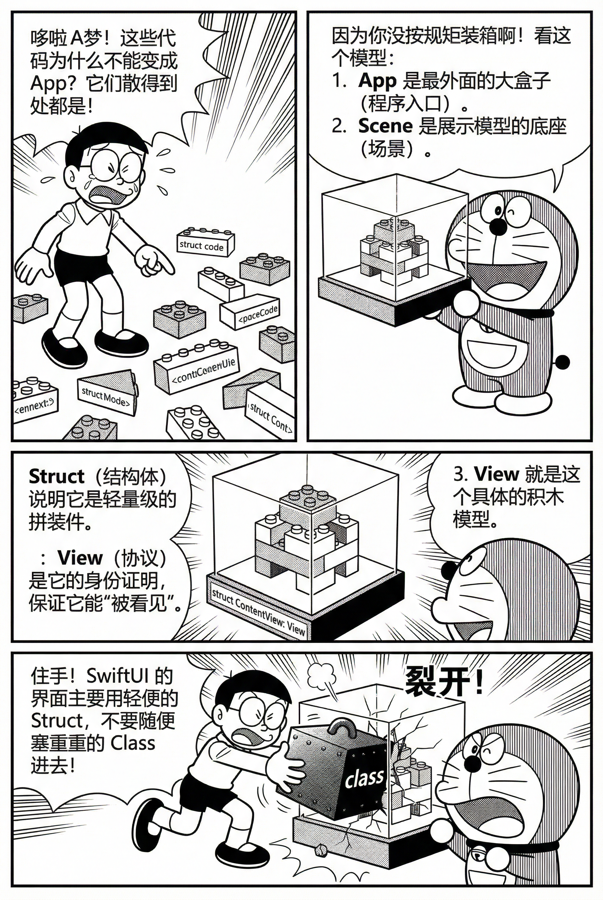
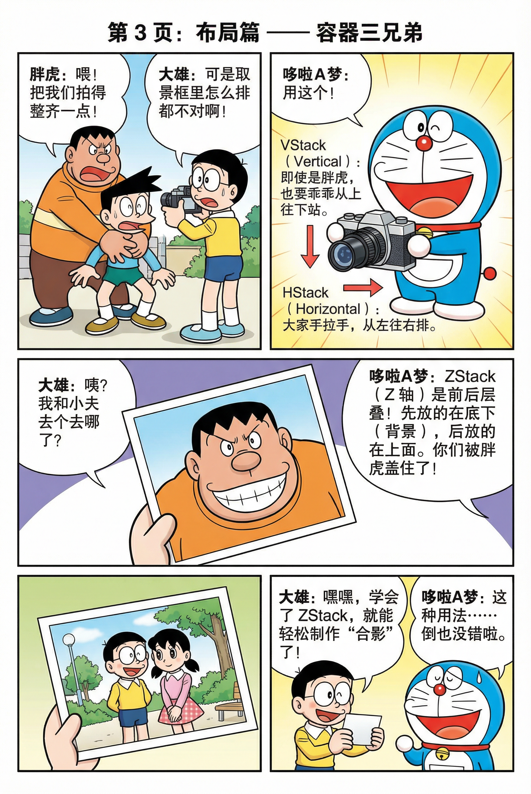
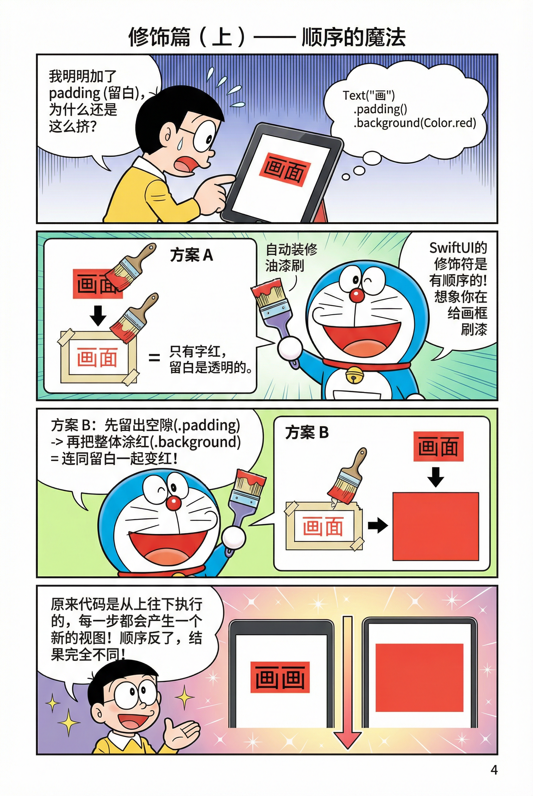
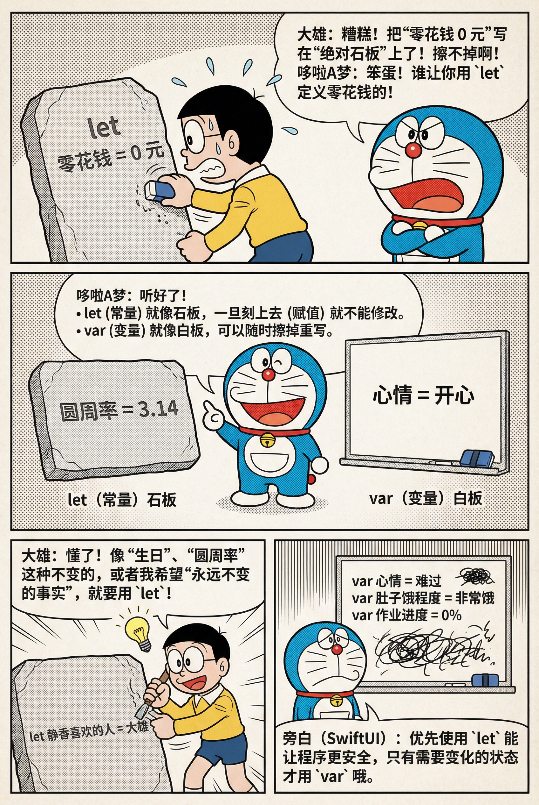
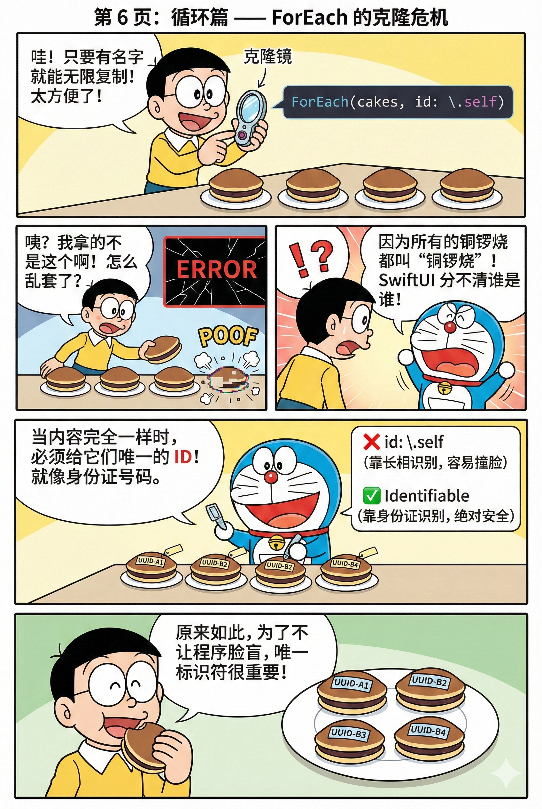
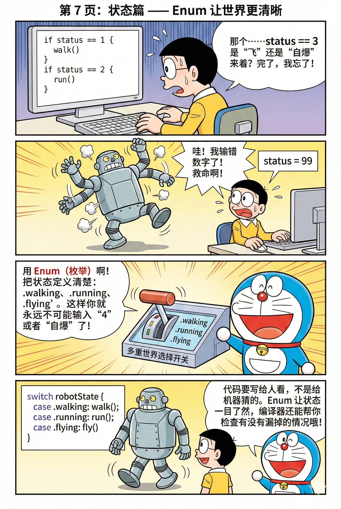

<MagArticle :title="$frontmatter.title" :description="$frontmatter.description" :date="$frontmatter.date" issue="01" category="Winter Swift · 第一讲" kind="活动讲义" author="JLU iOS Club" date-label="记录日期" :numbered="false" :next="{ title: 'Swift 进阶，让游戏运转起来', href: '/activities/260209-winter-swift/second' }">

从一个 CodeBreaker 界面开始，认识 SwiftUI 的声明式结构、布局和状态表达。跟随讲义在 Xcode 中逐段修改与预览，理解代码如何变成屏幕上的画面。

<details id="目录" class="article-contents">
<summary>阅读目录 · 14 节</summary>
<ol>
<li><a href="#_1-swift-与-swiftui-的一句话理解">1) Swift 与 SwiftUI 的一句话理解</a></li>
<li><a href="#_2-xcode-三大区域-左中右怎么用">2) Xcode 三大区域：左中右怎么用</a></li>
<li><a href="#_3-swiftui-核心结构-app-scene-view-struct-protocol">3) SwiftUI 核心结构：App / Scene / View / struct / protocol</a></li>
<li><a href="#_4-布局容器-vstack-hstack-zstack">4) 布局容器：VStack / HStack / ZStack</a></li>
<li><a href="#_5-modifier-修饰符-顺序为何会改变结果">5) modifier 修饰符：顺序为何会改变结果</a></li>
<li><a href="#_6-codebreaker-页面拆解">6) CodeBreaker 页面拆解</a></li>
<li><a href="#_7-数据与珠子视图-let-var-与可扩展-pegs">7) 数据与珠子视图：let/var 与可扩展 Pegs</a></li>
<li><a href="#_8-foreach-循环与-id-的坑">8) ForEach：循环与 id 的坑</a></li>
<li><a href="#_9-matchpegs-黑钉-白钉-空-深色模式">9) MatchPegs：黑钉/白钉/空 + 深色模式</a></li>
<li><a href="#_10-enum-让状态表达更清楚">10) enum：让状态表达更清楚</a></li>
<li><a href="#_11-常见错误清单">11) 常见错误清单</a></li>
<li><a href="#_12-任务与挑战">12) 任务与挑战</a></li>
<li><a href="#_13-实现约束">13) 实现约束</a></li>
<li><a href="#这节课真正要带走的能力">这节课真正要带走的能力</a></li>
</ol>
</details>

<div class="article-facts">

**学习目标。** 理解 SwiftUI 的声明式与状态驱动模型

**核心能力。** 布局容器、修饰符顺序、组件封装、枚举建模

**实践方式。** 以 CodeBreaker UI 为主线，边讲边改边预览

**适配要求。** iPhone 运行正常，Light / Dark Mode 都可读

</div>

<MagNote type="tip">
<strong>阅读建议：</strong> 按章节顺序走一遍，并在 Xcode 同步跟敲。每一节里都给了最小可运行写法。
<br />
<strong>项目 GitHub：</strong>
<a href="https://github.com/Hean-Yi/CodeBreaker.git" target="_blank" rel="noreferrer">https://github.com/Hean-Yi/CodeBreaker.git</a>
</MagNote>

## 1) Swift 与 SwiftUI 的一句话理解

<p><strong>Swift</strong> 是现代多范式语言，支持面向对象、面向协议和函数式特性。</p>
<p><strong>SwiftUI</strong> 是声明式、状态驱动的 UI 框架。你描述“当前状态下界面应该是什么样”，状态变了，界面自动同步刷新。</p>
<p>直观对比：UIKit 更像手工搬砖，SwiftUI 更像配置目标效果。</p>

## 2) Xcode 三大区域：左中右怎么用

<ul>
<li><strong>左侧 Project Navigator：</strong> 文件与资源管理，如 <code v-pre>Assets.xcassets</code> 与 Swift 文件。</li>
<li><strong>中间 Editor：</strong> 代码编辑与报错定位。</li>
<li><strong>右侧 Canvas Preview：</strong> 实时预览 UI，学习阶段建议常开。</li>
</ul>

## 3) SwiftUI 核心结构：App / Scene / View / struct / protocol

### 1. 从入口到视图：先理解“层级关系”

<p><code v-pre>@main</code> 声明应用入口，<code v-pre>App</code> 提供 <code v-pre>Scene</code>，<code v-pre>Scene</code> 承载页面，页面由 <code v-pre>View</code> 组成，通常以 <code v-pre>struct</code> 实现。</p>
<MagFigure caption="图 1：App / Scene / View / Struct 的层级和职责。">

</MagFigure>
<p>关键理解：<code v-pre>some View</code> / <code v-pre>some Scene</code> 是不透明返回类型。你返回的是具体类型，但对外隐藏类型细节。</p>

## 4) 布局容器：VStack / HStack / ZStack

### 2. 容器决定方向，修饰符决定观感

<ul>
<li><code v-pre>VStack</code>：从上到下排。</li>
<li><code v-pre>HStack</code>：从左到右排。</li>
<li><code v-pre>ZStack</code>：前后叠放，后写的盖在前面。</li>
</ul>
<MagFigure caption="图 2：容器三兄弟对应三种排布模型。">

</MagFigure>

## 5) modifier 修饰符：顺序为何会改变结果

### 3. 修饰符是“逐层包裹”，不是独立开关

<p>同一组修饰符，顺序不同，最终渲染不同。最常见是 <code v-pre>padding</code> 与 <code v-pre>background</code>。</p>
<MagFigure caption="图 3：`padding` 与 `background` 顺序变化会改变背景覆盖范围。">

</MagFigure>
<p>进阶组合也一样：<code v-pre>clipShape</code>、<code v-pre>shadow</code>、<code v-pre>frame</code>、<code v-pre>onTapGesture</code> 的先后会影响视觉与交互命中范围。</p>
<MagFigure caption="图 4：修饰器链路会影响阴影是否可见、点击区域是否正确。">

</MagFigure>

## 6) CodeBreaker 页面拆解

<p>本次课堂先实现基础版 UI，可拆成两块：</p>
<ul>
<li>一排猜测珠子（Pegs Row）。</li>
<li>一组反馈钉子（MatchPegs，2x2 布局）。</li>
</ul>

## 7) 数据与珠子视图：let/var 与可扩展 Pegs

### 4. 变量语义：优先 let，必要时再 var

<p>不变数据优先 <code v-pre>let</code>，变化数据再用 <code v-pre>var</code>。这会直接减少状态错误和误改。</p>
<MagFigure caption="图 5：常量与变量职责分离，有助于代码稳定性。">

</MagFigure>
<p>珠子行建议写成可扩展函数或组件，支持 3~6 个甚至更多：</p>

```swift
func pegsView(colors: [Color]) -> some View {
    HStack {
        ForEach(colors.indices, id: \.self) { index in
            RoundedRectangle(cornerRadius: 10)
                .foregroundStyle(colors[index])
                .aspectRatio(1, contentMode: .fit)
        }
    }
}
```

## 8) ForEach：循环与 id 的坑

### 5. 重复元素不要直接用 `id: \.self`

<p>当数组内元素可能重复（例如两个相同颜色），<code v-pre>id: \.self</code> 可能导致身份冲突。更稳妥的是用下标或 <code v-pre>Identifiable</code>。</p>
<MagFigure caption="图 6：ForEach 的核心不是“循环”，而是“稳定身份识别”。">

</MagFigure>

## 9) MatchPegs：黑钉/白钉/空 + 深色模式

<ul>
<li><code v-pre>exact</code>：黑钉（颜色对、位置对）。</li>
<li><code v-pre>inexact</code>：白钉（颜色对、位置错）。</li>
<li><code v-pre>noMatch</code>：空钉（透明占位，保留布局）。</li>
</ul>
<p>配色建议使用语义色（如 <code v-pre>.primary</code>），让 Light / Dark 自动适配，避免手写颜色在深色模式失真。</p>

## 10) enum：让状态表达更清楚

### 6. 不要用魔法数字表达状态

<p>用 <code v-pre>enum</code> 明确状态语义，<code v-pre>switch</code> 分发行为，可读性和可维护性都更高。</p>
<MagFigure caption="图 7：枚举能把“看不懂的数字状态”升级为“可读的业务状态”。">

</MagFigure>

```swift
enum Match {
    case exact
    case inexact
    case noMatch
}
```

## 11) 常见错误清单

<ol>
<li>返回视图的函数请写 <code v-pre>-&gt; some View</code>，不要写 <code v-pre>-&gt; View</code>。</li>
<li>统计计数通常用 <code v-pre>filter { ... }.count</code>。</li>
<li>ForEach 的 <code v-pre>id</code> 要稳定，不要盲目 <code v-pre>\.self</code>。</li>
<li>深色模式尽量使用语义色（<code v-pre>.primary</code>、<code v-pre>.secondary</code>）。</li>
</ol>

## 12) 任务与挑战

<div class="article-facts">

**任务 1-3（基础必做）。**

<ul>
<li>完成 CodeBreaker UI 原型：Pegs + MatchMarkers。</li>
<li>做原生场景 Preview：dummy pegs + MatchMarkers 组合预览。</li>
<li>让 MatchMarkers 支持 3~6 个结果，不写死 4 个。</li>
</ul>

**任务 4-6（验证完整性）。**

<ul>
<li>Preview 覆盖 3/4/5/6 以及混合状态组合。</li>
<li>dummy pegs 数量需与 matches 数量一致。</li>
<li>Light / Dark 都要验证可读性与边界表现。</li>
</ul>

**挑战 1-2（组件化）。**

<ul>
<li><code v-pre>PegsRow</code> 与 <code v-pre>MatchMarkers</code> 组件化，外部只传数据。</li>
<li>peg 数量参数化（3~6），Preview 里做参数扫描。</li>
</ul>

**挑战 3-4（工程化 + 视觉）。**

<ul>
<li>做异常输入保护（截断/断言/可读 debug 信息）。</li>
<li>尝试 Material 拟态玻璃效果并保持深浅色可读。</li>
</ul>

</div>

## 13) 实现约束

<MagNote>
<ul>
<li>状态表达：<code v-pre>enum Match { case exact, inexact, noMatch }</code>。</li>
<li>ForEach：提供稳定 id（下标或 <code v-pre>Identifiable</code>）。</li>
<li>允许在 View 里用 <code v-pre>if</code> 分支处理显示逻辑（<code v-pre>@ViewBuilder</code> 语义下）。</li>
<li>项目里至少体现一次“修饰符顺序影响结果”的正确实践。</li>
</ul>
</MagNote>

## 这节课真正要带走的能力

把讲义中的概念用到自己的项目里，在修改、运行与解释代码的过程中巩固理解。

</MagArticle>
