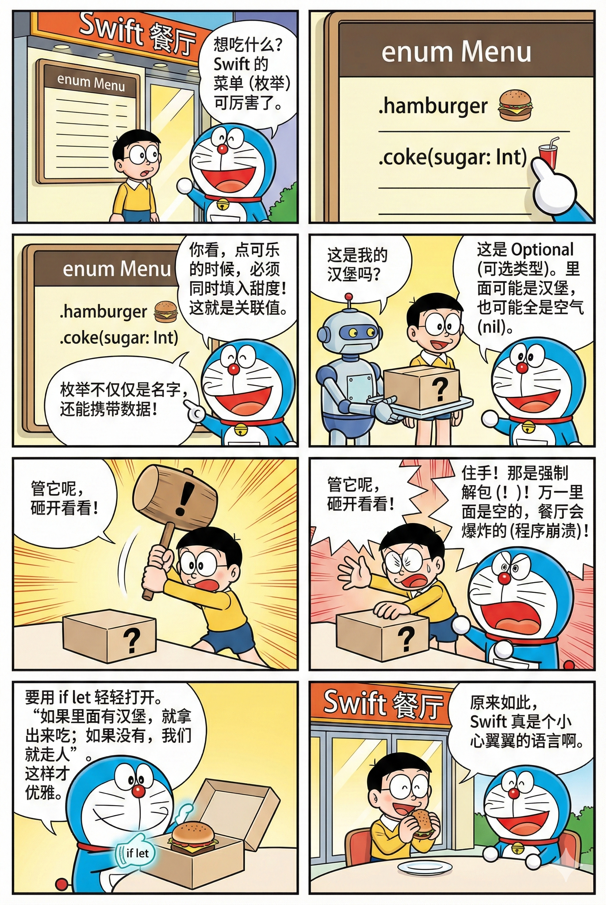
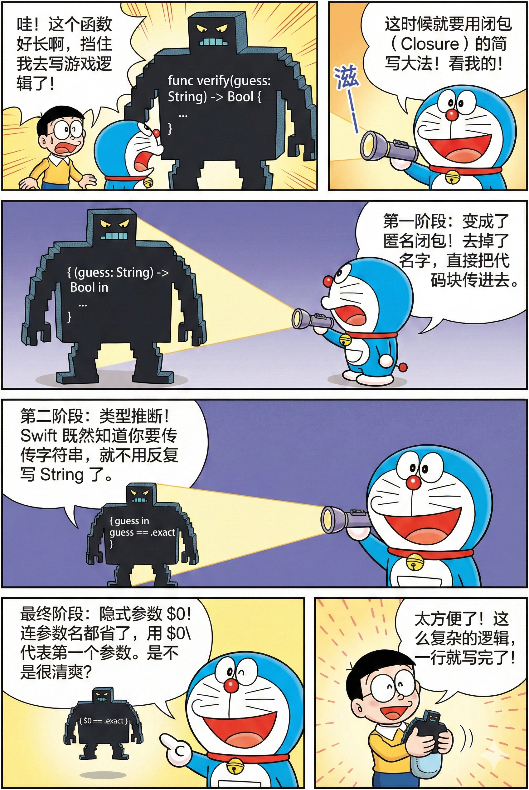
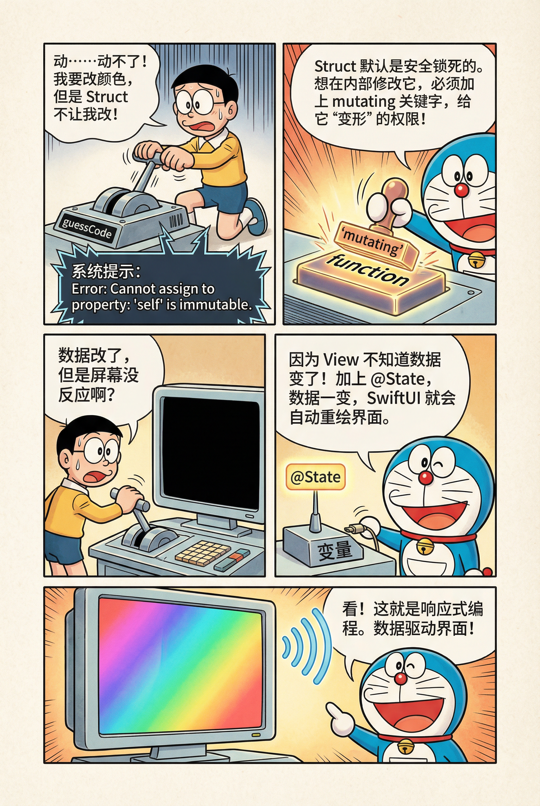
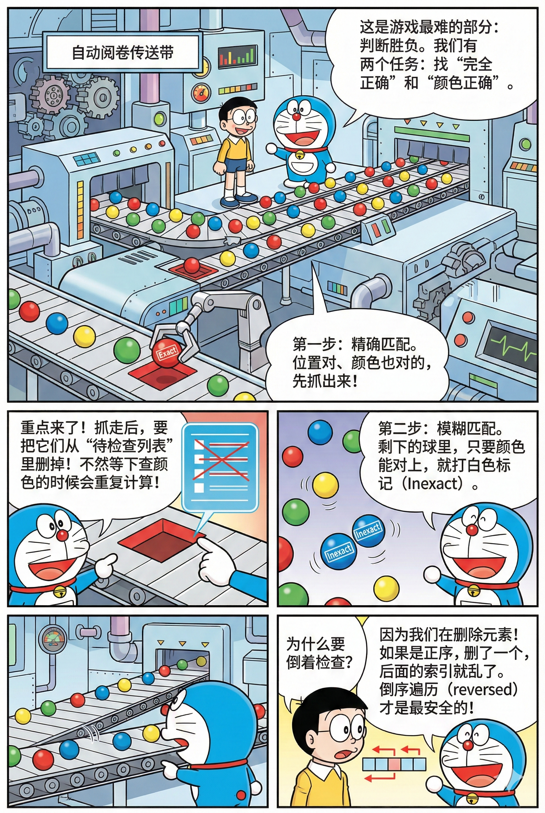

<MagArticle :title="$frontmatter.title" :description="$frontmatter.description" :date="$frontmatter.date" issue="02" category="Winter Swift · 第二讲" kind="活动讲义" author="JLU iOS Club" date-label="记录日期" :numbered="false" :next="{ title: '现代 AI 编程全景', href: '/activities/260209-winter-swift/bonus-ai-programming' }">

有了基础界面，下一步是让游戏真正运转。这一讲围绕 CodeBreaker 的数据模型、交互状态与匹配算法，练习如何组织代码并解释自己的设计。

<details id="目录" class="article-contents">
<summary>阅读目录 · 10 节</summary>
<ol>
<li><a href="#_1-架构设计回顾-mvvm-模式">1) 架构设计回顾：MVVM 模式</a></li>
<li><a href="#_2-swift-类型系统复习-struct-class、enum-optional">2) Swift 类型系统复习：Struct / Class、Enum / Optional</a></li>
<li><a href="#_3-从函数到闭包-closure">3) 从函数到闭包（Closure）</a></li>
<li><a href="#_4-codebreaker-model-设计">4) CodeBreaker Model 设计</a></li>
<li><a href="#_5-交互逻辑-mutating-与-state">5) 交互逻辑：mutating 与 @State</a></li>
<li><a href="#_6-核心算法-匹配逻辑-exact-inexact">6) 核心算法：匹配逻辑（Exact / Inexact）</a></li>
<li><a href="#_7-ui-完善与工程化细节">7) UI 完善与工程化细节</a></li>
<li><a href="#_8-课后任务-必做-挑战">8) 课后任务（必做 + 挑战）</a></li>
<li><a href="#_9-实现约束与检查清单">9) 实现约束与检查清单</a></li>
<li><a href="#第二讲核心收获">第二讲核心收获</a></li>
</ol>
</details>

<div class="article-facts">

**学习重心。** 把“会写代码”升级为“能组织结构并解释设计”。

**核心能力。** 值类型思维、状态驱动 UI、可维护算法实现。

**项目主线。** 围绕 CodeBreaker：从 Model 到交互再到反馈计算。

**课后方向。** 模式扩展、参数化重构、视觉风格升级。

</div>

<MagNote type="tip">
<strong>建议阅读方式：</strong> 先看每节“结论”，再看代码与图片。遇到疑问时回到第一讲对照基础概念。
</MagNote>

## 1) 架构设计回顾：MVVM 模式

### 1. 把界面和规则拆开，是可维护性的起点

<ul>
<li><strong>Model：</strong> 数据与规则（例如密码、判定逻辑、历史记录）。</li>
<li><strong>View：</strong> 界面展示（颜色块、按钮、布局）。</li>
<li><strong>ViewModel：</strong> 连接 View 与 Model，处理“用户操作 -> 状态更新”。</li>
</ul>
<p>本项目规模不大，可以简化实现，但思维上仍要坚持关注点分离。</p>
<MagFigure caption="图 1：MVVM 的关键是职责拆分，不是为了“套模式”而套模式。">

</MagFigure>

## 2) Swift 类型系统复习：Struct / Class、Enum / Optional

### 2. Struct vs Class：值语义与引用语义

<p><code v-pre>struct</code> 是值类型，赋值时拷贝；<code v-pre>class</code> 是引用类型，多个变量可指向同一对象。能用 Struct 时优先 Struct，尤其适合状态与数据模型。</p>
<MagFigure caption="图 2：值类型更安全，引用类型更灵活，关键看是否需要共享可变状态。">

</MagFigure>

```swift
struct Resolution {
    var width = 0
    var height = 0
}

class VideoMode {
    var resolution: Resolution
    var interlaced: Bool

    init(resolution: Resolution, interlaced: Bool) {
        self.resolution = resolution
        self.interlaced = interlaced
    }
}
```

### 3. Enum 与 Optional：表达状态，不赌运气

<p>枚举不仅能列选项，还能携带关联值。Optional 代表“可能为空”，请优先 <code v-pre>if let</code> 安全解包，避免强制解包崩溃。</p>
<MagFigure caption="图 3：枚举让状态语义化，Optional 让空值处理显式化。">

</MagFigure>

```swift
enum Menu {
    case hamburger
    case coke(sugar: Int)
}

if let safeValue = maybeValue {
    print(safeValue)
}
```

## 3) 从函数到闭包（Closure）

### 4. 闭包简写不是炫技，是降低噪音

<p>在不损失可读性的前提下，闭包可逐步简化：完整参数写法 -> 类型推断 -> <code v-pre>$0</code> 隐式参数。</p>
<MagFigure caption="图 4：闭包演进重点是“保留语义，减少样板代码”。">

</MagFigure>

```swift
// 完整写法
let exactCount1 = matches.filter { match in
    match == .exact
}.count

// 简写
let exactCount2 = matches.filter { $0 == .exact }.count
```

## 4) CodeBreaker Model 设计

<p>本讲把游戏逻辑收敛到 Model，View 负责展示，避免把业务细节堆到界面层。</p>

```swift
typealias Peg = Color

struct CodeBreaker {
    var masterCode = Code(kind: .master)
    var guessCode = Code(kind: .guess)
    var attempts: [Code] = []
    let pegChoices: [Peg] = [.blue, .red, .green, .yellow]
}

struct Code {
    var pegs: [Peg] = Array(repeating: .clear, count: 4)
    var kind: Kind

    enum Kind: Equatable {
        case master
        case guess
        case attempt(matches: [Match])
    }
}
```

## 5) 交互逻辑：`mutating` 与 `@State`

### 5. 数据要改得动，界面要跟得上

<ul>
<li><code>mutating</code>：允许值类型方法修改自身属性。</li>
<li><code>@State</code>：告诉 SwiftUI 这是会驱动界面刷新的状态。</li>
</ul>
<MagFigure caption="图 5：值类型修改与界面响应要配套，否则会出现“数据变了但UI不刷新”。">

</MagFigure>

```swift
mutating func changeGuessPeg(at index: Int) {
    let existingPeg = guessCode.pegs[index]
    if let currentIndex = pegChoices.firstIndex(of: existingPeg) {
        let nextIndex = (currentIndex + 1) % pegChoices.count
        guessCode.pegs[index] = pegChoices[nextIndex]
    } else {
        guessCode.pegs[index] = pegChoices.first ?? .clear
    }
}
```

## 6) 核心算法：匹配逻辑（Exact / Inexact）

### 6. 两阶段判定：先精确，再模糊

<p>先处理位置和颜色都正确（Exact），并从待匹配序列中移除；再处理颜色对但位置错（Inexact）。删除元素时使用倒序遍历，避免索引错乱。</p>
<MagFigure caption="图 6：匹配算法的关键是“先精确扣除，再模糊匹配”。">

</MagFigure>

```swift
func match(against otherCode: Code) -> [Match] {
    var results = Array(repeating: Match.noMatch, count: pegs.count)
    var pegsToMatch = otherCode.pegs

    for index in pegs.indices.reversed() {
        if pegsToMatch[index] == pegs[index] {
            results[index] = .exact
            pegsToMatch.remove(at: index)
        }
    }

    // 第二阶段：在剩余元素中处理 inexact
    return results
}
```

## 7) UI 完善与工程化细节

<ul>
<li>历史记录使用 <code v-pre>ScrollView</code>，避免内容超出屏幕。</li>
<li>用 <code v-pre>indices.reversed()</code> 控制最近一次尝试显示顺序。</li>
<li>提交动作配合 <code v-pre>withAnimation</code> 提升反馈感。</li>
<li>透明区域用 <code v-pre>.contentShape(Rectangle())</code> 提高可点性。</li>
<li>随机初始化题目，提升重复游玩体验。</li>
</ul>

## 8) 课后任务（必做 + 挑战）

<div class="article-facts">

**必做任务。**

<ul>
<li>复现课堂 Lecture 1-4 功能，确保可运行。</li>
<li>忽略无效猜测（空输入、重复尝试）。</li>
<li>新增 Restart 并随机 Peg 数量（3~6）。</li>
<li>支持颜色模式与 Emoji 模式随机切换。</li>
</ul>

**界面任务。**

<ul>
<li>让 Emoji 在不同 Peg 数量下可读（缩放策略）。</li>
<li>加入 iOS 风格液态玻璃视觉（Material + 高光）。</li>
<li>深色模式下保持边界与对比度清晰。</li>
</ul>

**挑战任务。**

<ul>
<li>扩展颜色库并做字符串到颜色映射。</li>
<li>主题系统（车辆 / 脸部 / 大地色等）。</li>
<li>界面显示当前主题名称。</li>
</ul>

**工程要求。**

<ul>
<li>代码命名清晰、无警告、可读性优先。</li>
<li>至少使用一次 <code v-pre>static</code> 成员。</li>
<li>Model 层保持 UI 无关，减少 <code v-pre>SwiftUI</code> 依赖。</li>
</ul>

</div>

## 9) 实现约束与检查清单

<MagNote>
<ul>
<li>状态建模优先 <code v-pre>enum</code>，不要散落魔法数字。</li>
<li>ForEach 需稳定 id（<code v-pre>indices</code> 或 <code v-pre>Identifiable</code>）。</li>
<li>涉及可变状态时，明确 <code v-pre>mutating</code> 与 <code v-pre>@State</code> 边界。</li>
<li>算法代码先追求正确性，再谈短写法。</li>
</ul>
</MagNote>

## 第二讲核心收获

把讲义中的概念用到自己的项目里，在修改、运行与解释代码的过程中巩固理解。

</MagArticle>
