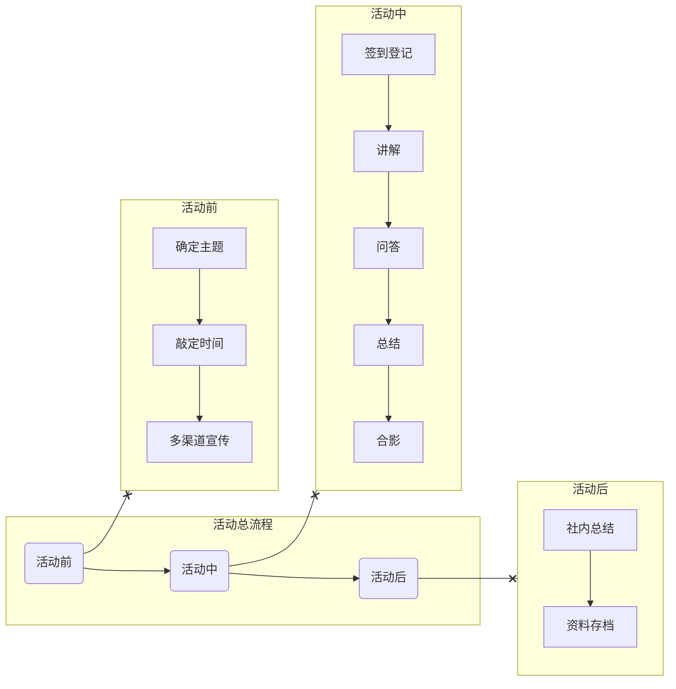

<MagHero
  eyebrow="Archive"
  title="社团活动"
  subtitle="从入门讲座到实战工作坊，这里是社团历次活动的完整记录。选择一篇记录，继续阅读。"
/>

<MagNote title="想从一个小作品开始？" type="tip">

[从想法到作品：AI 编程入门](/resources/ai-programming/) 是面向新生的长期讲义专题。六章主线配有交互演示、随查和下载材料，可以按自己的节奏阅读。

</MagNote>

<MagArchive source="activities" />

## 更早期的活动

以下活动早于本站建立，暂未整理成记录页。

  <MagBadge>解锁 iPad 生产力</MagBadge>
  <MagBadge>2023 冬季 WWDC - Swift 特训营</MagBadge>
  <MagBadge>购买 Mac / iPad 迎接高校生活</MagBadge>
  <MagBadge>macOS 初体验</MagBadge>

## 活动流程

